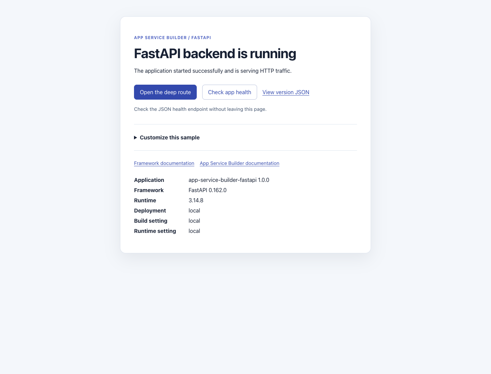

# App Service Builder: FastAPI sample

A standalone FastAPI application served by Uvicorn for learning how to deploy
GitHub source with [Azure App Service Builder](https://builder.appservice.azure.com/docs/).
It serves HTML pages, JSON API endpoints, and a stylesheet from one Python
process. There is no compilation step, database, external service, or parent
workspace dependency.

**App Service Builder is in Private Preview. Use this sample for development
and testing, not as a production application template.** The original sample
was successfully deployed with the included manifest. The renamed repository
must still be deployed and verified in your authorized preview environment;
local tests do not establish cloud deployment success or regional availability.

## Sample preview



Rendered locally at `/` with sample settings. This screenshot is not evidence of
an Azure deployment.

**Check app health** reads this app's `/health` JSON endpoint and displays the
result in place, including failures and retry guidance. It does not report Azure
deployment status. **Customize this sample** explains which files to edit in
your fork; it does not guess your repository or app URL. Framework and App
Service Builder documentation are labeled separately.

## Features

- Server-rendered landing and product pages, including direct deep links.
- JSON health, availability, application identity, and request metadata routes.
- Separate HTML and JSON responses for missing pages and API routes.
- A root-level `builder.yaml` with an explicit startup and health contract.
- Automated HTTP tests using pytest and FastAPI's test client.
- An OpenAPI schema without the interactive documentation UI.

## Prerequisites

- [Python 3.14](https://www.python.org/downloads/) is recommended; the source
  requires Python 3.11 or later.
- [Git](https://git-scm.com/) and a GitHub account.
- For deployment: App Service Builder Private Preview access, an authorized
  Azure subscription, and an existing resource group in a supported preview
  location.
- Optional: [PowerShell 7](https://learn.microsoft.com/powershell/scripting/install/installing-powershell)
  for the endpoint verification script.

FastAPI **0.162.0** and Uvicorn **0.54.0** are pinned in `requirements.txt`.
Development dependencies are listed separately in `requirements-dev.txt`.
Transitive dependencies are resolved by pip; these files are not a complete
dependency lock.

## Run locally

Fork
[AzureAppService/app-service-builder-fastapi](https://github.com/AzureAppService/app-service-builder-fastapi/fork)
to your GitHub account. Clone your fork, replacing `<your-github-account>`:

```sh
git clone https://github.com/<your-github-account>/app-service-builder-fastapi.git
cd app-service-builder-fastapi
python -m venv .venv
```

### Windows PowerShell

Use the virtual environment's interpreter directly; activation is not required:

```powershell
.\.venv\Scripts\python -m pip install -r requirements.txt
.\.venv\Scripts\python main.py
```

### Linux or macOS

Use `python3` instead of `python` to create the virtual environment if needed:

```sh
.venv/bin/python -m pip install -r requirements.txt
.venv/bin/python main.py
```

Open `http://localhost:8080/`. Expect the heading
`FastAPI backend is running`. Follow the product link or open
`http://localhost:8080/products/widget-1` directly.

In another terminal:

```sh
curl -i http://localhost:8080/health
curl -i http://localhost:8080/api/version
```

Both should return HTTP 200 with JSON. Health includes `"status":"ok"` and
application identity includes `"app":"app-service-builder-fastapi"`.

The server reads `PORT`, defaults to `8080`, and binds to `0.0.0.0`. Run it only
on a trusted development network and stop it with Ctrl+C. To use another port
in PowerShell:

```powershell
$env:PORT = "8081"
.\.venv\Scripts\python main.py
```

## Build and test

There is no build step. From the repository root, install the development
dependencies and run the tests.

Windows PowerShell:

```powershell
.\.venv\Scripts\python -m pip install -r requirements-dev.txt
.\.venv\Scripts\python -m pytest
```

Linux or macOS:

```sh
.venv/bin/python -m pip install -r requirements-dev.txt
.venv/bin/python -m pytest
```

Tests use an in-process HTTP client without binding a network port. They check
HTML pages, JSON endpoints, public marker escaping, request-header filtering,
the stylesheet, the OpenAPI schema, and missing routes. GitHub Actions runs
these checks on Linux and Windows with Python 3.14.

With the application running, optionally check the local or deployed endpoint
using PowerShell 7:

```powershell
pwsh -NoProfile -File .\scripts\verify.ps1 -BaseUrl http://localhost:8080
```

For a deployed app, replace the base URL with the HTTPS runtime URL shown by
Builder Portal.

## Routes

| Route | Expected response |
|---|---|
| `/` | HTTP 200, HTML landing page and application details |
| `/products/widget-1` | HTTP 200, server-rendered product page |
| `/health` | HTTP 200, JSON health status and application identity |
| `/api/status` | HTTP 200, JSON availability status and timestamp |
| `/api/version` | HTTP 200, JSON application, FastAPI, Python, and public deployment markers |
| `/api/request` | HTTP 200, JSON method, path, and selected request headers |
| `/assets/styles.v2.css` | HTTP 200, stylesheet |
| `/assets/health.v1.js` | HTTP 200, browser-only inline health action |
| `/openapi.json` | HTTP 200, generated OpenAPI schema |
| `/api/missing` | HTTP 404, JSON API error |
| `/missing-page` | HTTP 404, HTML not-found page |

`/docs` and `/redoc` are disabled. `/api/request` returns only the host,
user-agent, and forwarded-protocol headers; it does not return authorization
or cookie headers. The diagnostic routes are public and unauthenticated.

## Deployment contract

The repository root contains `builder.yaml`:

```yaml
components:
  - name: web
    role: web
    platform: python
    path: /
    run:
      port: 8080
      start: python main.py
      healthCheckPath: /health
```

This declares one public Python web component at `/`. The source directory
defaults to the repository root. Builder installs `requirements.txt` and runs
`python main.py`. Uvicorn serves FastAPI, and FastAPI serves both pages and
assets. There is no `dist/` output, static-site component, or frontend
development server to deploy. Test-only dependencies are not needed at runtime.

The manifest intentionally leaves the supported Python version to Builder.
Keep this file at the repository root: the original deployment required it.

## Deploy your fork through Builder Portal

Follow the [Portal quickstart](https://builder.appservice.azure.com/docs/quickstarts/portal/)
for your authorized Private Preview environment:

1. Commit and push the sample to the `main` branch of your GitHub repository.
   Builder uses committed GitHub source, not local files.
2. Open Builder Portal and select your enabled subscription, existing resource
   group, and supported preview location.
3. Connect GitHub and authorize the Builder GitHub app to access your repository.
   Obtain organization-owner approval if required.
4. Create an app using your repository, branch `main`, and the repository root
   as its source directory. Do not select `public/`.
5. Explicitly start deployment and wait for a successful terminal status.
   Connecting a source or pushing a commit is not proof of deployment.
6. Open the returned runtime URL. Verify `/`, `/products/widget-1`, `/health`,
   `/api/version`, and the stylesheet. Confirm missing routes return HTTP 404.

### Public deployment markers

The optional `DEPLOYMENT_MARKER`, `BUILD_MARKER`, and `RUNTIME_MARKER` environment
variables are displayed on HTML pages and returned by `/api/version`.
`DEPLOYMENT_MARKER` also appears in `/health`. They default to `local`.

All three are read by the running server, including `BUILD_MARKER`; none is
compiled into an artifact. Values are escaped when displayed in HTML. Use
them only for public demo labels. **Never put credentials, connection strings,
or private information in these values.**

Configure them through Portal **Variables**, then deploy to apply them to the
running application. Saving a variable alone does not establish that the
current deployment changed. See the
[variables guide](https://builder.appservice.azure.com/docs/guides/variables/).

### Update and redeploy

Edit the application, run the tests, commit, and push to your fork's `main`
branch. Explicitly deploy through Builder Portal, wait for completion, and
verify the public endpoint again. Automatic deployment on push is not
qualified by this sample.

### Cleanup

Delete only the Builder app you created and wait for deletion to complete.
Do not delete a shared resource group, subscription, or unrelated resources.
Deleting the app does not delete your GitHub repository or local clone.

## Resources and contributions

- [App Service Builder documentation](https://builder.appservice.azure.com/docs/)
- [Sample catalog](https://builder.appservice.azure.com/docs/samples/)
- [Manifest guide](https://builder.appservice.azure.com/docs/guides/builder-yaml/)
- [Contributing](CONTRIBUTING.md)
- [Code of Conduct](.github/CODE_OF_CONDUCT.md)
- [Security reporting](SECURITY.md)
- [Changelog](CHANGELOG.md)
- [MIT license](LICENSE.md)
